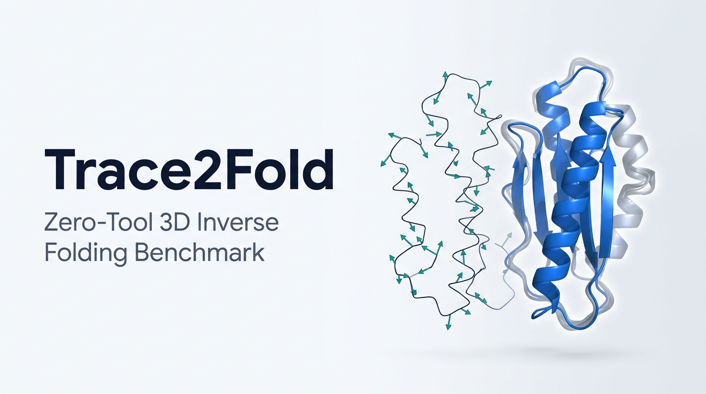

# Trace2Fold: Zero-Tool 3D Inverse Folding Benchmark

[](LICENSE)
[](pyproject.toml)
[](https://jvogan.github.io/trace2fold/)
[](#benchmark-data-and-rankings)

**Inverse folding** is the task of designing an amino-acid sequence whose folded 3D protein structure matches a target backbone. **Trace2Fold** tests whether frontier language models can design sequences directly from anonymous 3D backbone coordinates in one zero-tool turn, without code execution, templates, or sequence databases.

Our published evaluation covers 24 private holdout shapes (`12` matched A/B twin pairs across `48`, `80`, `112`, and `176` residues), 14 frontier model settings, 2 null baselines (`Composition shuffle`, `1D H/E/C rule`), and 3 specialist ceilings (`Cα-ProteinMPNN`, `Vanilla ProteinMPNN`, `RFD4-Proteina`).

Two primary single-sequence predictors (`ESMFold2-Fast` and `Boltz-2`) and one concordance predictor (`Apple SimpleFold 3B`) verify fold geometry without sequence alignments or structural templates.

**Quick links:** [Interactive Benchmark and 3D Explorer (GitHub Pages)](https://jvogan.github.io/trace2fold/) · [Headline Summary](#headline-results-at-a-glance) · [Quickstart](#run-trace2fold-yourself) · [How Trace2Fold Works](#how-trace2fold-works) · [Prompts and Extraction](#exact-benchmark-prompts-and-answer-extraction) · [Scoring Formula](#scoring-formula-and-why-the-spacefill-v4-weights-are-fair) · [Full Rankings](#benchmark-data-and-rankings) · [Findings and Limitations](#what-these-scores-tell-us-about-frontier-models) · [Tools and Cite](#benchmark-tools-and-academic-citations)

> **Interactive Explorer and Zero-GPU Demo**
> <!-- VIDEO_OVERVIEW_SLOT -->
> Open the [Interactive Benchmark and 3D Explorer](https://jvogan.github.io/trace2fold/) to inspect holdout score tables, length scaling, and 38 live 3D overlays on 6 bundled public development shapes. To test prompt generation, parsing, and `Twin Δ` scoring locally in under one second on CPU, run `uv run python examples/quickstart_demo.py`.

## Headline Results at a Glance

The primary score is seed-0 **Composite Fit** (`0` to `100` under `spacefill-v4`, two-predictor consensus of `ESMFold2-Fast` and `Boltz-2`), reported alongside a seed-0 **Twin Δ** (`Fit(Assigned A) − Fit(Decoy Twin B)`) specificity margin over all assigned targets (`0.00` when no sequence folds). Specialist rows are reference controls (`4` draws selected by internal model log-likelihood).

| Tier | Representative setting | Stage 1 (18 shapes, 48–112 aa) | Stage 2 (6 shapes, 176 aa) | All 24 shapes | Stage 1 / Stage 2 Twin Δ |
| --- | --- | ---: | ---: | ---: | ---: |
| Specialist reference control | `Vanilla ProteinMPNN` (4-atom, 4 draws, log-likelihood) | 91.37 | 93.15 | 91.81 | +69.29 / +81.53 |
| Specialist reference control | `Cα-ProteinMPNN` (Cα-only, 4 draws, log-likelihood) | 91.70 | 91.15 | 91.56 | +69.33 / +79.57 |
| Specialist reference control | `RFD4-Proteina` co-generated sequence | 90.87 | 91.40 | 91.00 | +68.97 / +79.84 |
| Top-tier zero-tool LLM | `Gemini 4 Carbon High` | 56.98 | 36.61 | 51.89 | +37.01 / +25.63 |
| Top-tier zero-tool LLM | `Gemini 4 Hydrogen XHigh` | 54.09 | 44.38 | 51.66 | +32.66 / +34.43 |
| Top-tier zero-tool LLM | `Gemini 4 Neon High` | 53.35 | 46.44 | 51.62 | +33.52 / +35.71 |
| 1D secondary-structure floor | `1D H/E/C rule` (0 coordinates) | 17.10 | 9.72 | 15.26 | +1.46 / +1.79 |
| Random composition floor | `Composition shuffle` | 8.79 | 6.56 | 8.23 | +0.00 / +0.00 |

See [Benchmark Data and Rankings](#benchmark-data-and-rankings) for all 14 evaluated LLM settings, paired reasoning-effort comparisons, `Vectors` versus `Pure-Cα` ablations, and `Genie 3` transfer scores.

## Run Trace2Fold Yourself

The public package installs with only `numpy` for local prompt generation, answer parsing, `spacefill-v4` grading, and offline benchmark verification. The repository bundles 20 public `gen-*` development shapes (`48`, `72`, and `96` residues) and 4 experimental PDB calibration fixtures (`1L2Y`, `1TRZ`, `1QY3`, `1I3V`) in `data/`; the 24 holdout backbones remain private.

### 1. Install the package and run the zero-GPU quickstart

```bash
git clone https://github.com/jvogan/trace2fold.git
cd trace2fold
uv sync        # or: pip install -e .
uv run python examples/quickstart_demo.py
```

`examples/quickstart_demo.py` loads the starter twin manifest [examples/starter_pilot_pairs.json](examples/starter_pilot_pairs.json) (`gen-l48-02-b` paired with `gen-l48-03-b`), prints both `v4.3` prompts, checks `length-aware-v2` extraction on a fenced reply, and computes `spacefill-v4` and `Twin Δ` in under one second on CPU.

### 2. List bundled cases and print exact `v4.3` prompts

```bash
uv run trace2fold list
uv run trace2fold prompt gen-l48-02-b --prompt-version v4.3 --condition vectors
uv run trace2fold prompt gen-l48-02-b --prompt-version v4.3 --condition geometry
```

### 3. Evaluate a model on a local loopback HTTP endpoint

```bash
uv run trace2fold plan runs/my-model \
  --cases gen-l48-02-b,gen-l48-03-b \
  --model my-model-name \
  --endpoint http://127.0.0.1:8000/v1/chat/completions \
  --conditions vectors \
  --prompt-version v4.3

uv run trace2fold run runs/my-model
uv run trace2fold fold-inputs runs/my-model/records runs/my-model/fold-inputs.json
```

`backends/plain_player.py` connects to trusted loopback OpenAI-compatible servers (`127.0.0.1` or `localhost`, including a local proxy forwarding to hosted APIs); you can also record replies directly into a JSONL file for `grade-v4`. Eleven of the 20 starter `gen-*` shapes include 4-atom (`N, Cα, C, O`) coordinates required for `vectors`; all 20 starter shapes support `--suite generated --conditions geometry`.

### 4. Fold predicted sequences (Modal or local predictors)

From a repository checkout, run the sequence-only Modal adapters (`uv sync --extra folding` or `pip install -e ".[folding]"`), or place local `ESMFold2-Fast` and `Boltz-2` folds under `runs/my-model/folds/esmfold2/<seq_id>.pdb` and `runs/my-model/folds/boltz2/<seq_id>.pdb`:

```bash
modal run backends/fold_modal.py \
  --inputs runs/my-model/fold-inputs.json \
  --output runs/my-model/folds/esmfold2

modal run -m backends.boltz_modal \
  --inputs runs/my-model/fold-inputs.json \
  --output runs/my-model/folds/boltz2
```

See [backends/README.md](backends/README.md) for Modal volume configuration (`TRACE2FOLD_BOLTZ_VOLUME`) and the `Apple SimpleFold 3B` research license workflow in [backends/README.simplefold.md](backends/README.simplefold.md). For worked examples of running the cited structure predictors and geometry tools (`ESMFold2-Fast`, `Boltz-2`, `SimpleFold 3B`, `ProteinMPNN`, `RFD4-Proteina`, `Genie 3`, `Foldseek`, and `US-align`), see [BioSymphony/structure-factory](https://github.com/BioSymphony/structure-factory).

### 5. Grade submissions and verify benchmark archives offline

```bash
uv run trace2fold grade-v4 \
  --submissions runs/my-model/records \
  --folds runs/my-model/folds \
  --twin-map examples/starter_pilot_pairs.json \
  --out runs/my-model/spacefill-v4-report.json

uv run trace2fold verify-benchmarks --benchmarks-dir benchmarks
```

`trace2fold grade-v4` requires both `esmfold2/` and `boltz2/` fold directories by default (`--allow-partial-judges` enables exploratory single-predictor runs) and isolates third predictors such as `simplefold/` under `exploratory_predictors`. Running `uv run trace2fold verify-benchmarks --benchmarks-dir benchmarks` checks all 5 canonical JSON archives, twin symmetry, and holdout-leak guards offline.

## How Trace2Fold Works

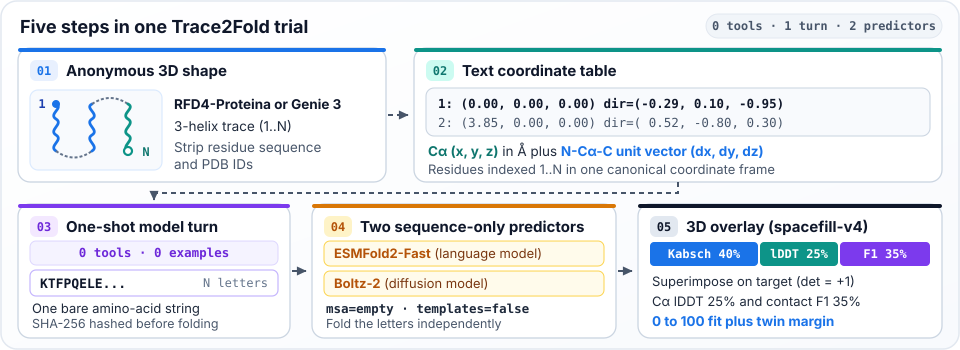

A protein backbone folds in three-dimensional space with coordinates measured in ångströms (`1 Å = 0.1 nm`). In Trace2Fold, each target is an ordered list of alpha-carbon (`Cα`) positions `(x, y, z)` along one chain of length `N`, with consecutive `Cα` atoms spaced `3.8 Å` apart.

The primary prompt adds a local side-chain direction unit vector `(dx, dy, dz)` at every position, derived from the target backbone `N`, `Cα`, and `C` atoms in the same coordinate frame. That unit vector tells the model which way each side chain points relative to the folded core and surrounding solvent, without disclosing any amino-acid identity.

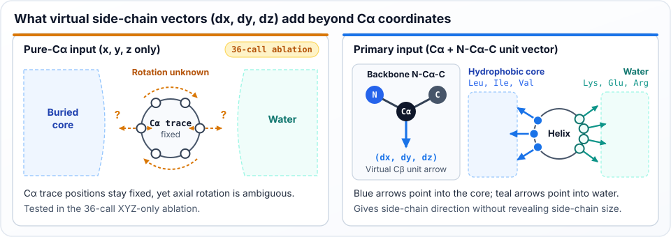

Naive inverse-folding tests fail when a model guesses a generic sequence from 1D secondary-structure patterns alone (`H` for alpha-helix, `E` for extended beta-strand, `C` for coil or turn). To defeat 1D shortcuts, Trace2Fold groups targets into **matched A/B twin pairs** that share identical length, identical fold class, and high per-residue `H/E/C` agreement.

Stage 1 pairs and the Stage 2 helical and mixed pairs share at least `70%` of their `H/E/C` labels; the 176-residue strand-rich pair shares `66.5%`. Despite matching in 1D, paired twins diverge sharply in 3D space (`>= 3.0 Å` Cα RMSD in Stage 1 and `>= 5.0 Å` in Stage 2).

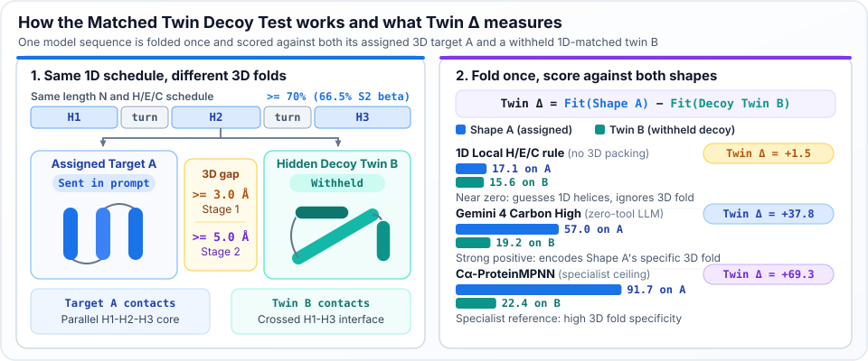

When a model receives target A, we fold its returned sequence independently with `ESMFold2-Fast` and `Boltz-2` in single-sequence, zero-MSA, zero-template mode. We then score the predicted 3D fold against both the assigned target A and its matched twin decoy B, reporting `Twin Δ = Fit(Assigned A) − Fit(Decoy Twin B)`.

A generic 1D rule scores near zero on `Twin Δ` (`+1.46` in Stage 1 and `+1.79` in Stage 2). Positive `Twin Δ` (`+37.01` for `Gemini 4 Carbon High` in Stage 1 and `+35.71` for `Gemini 4 Neon High` in Stage 2) establishes preference for the assigned 3D target over its matched 1D twin.

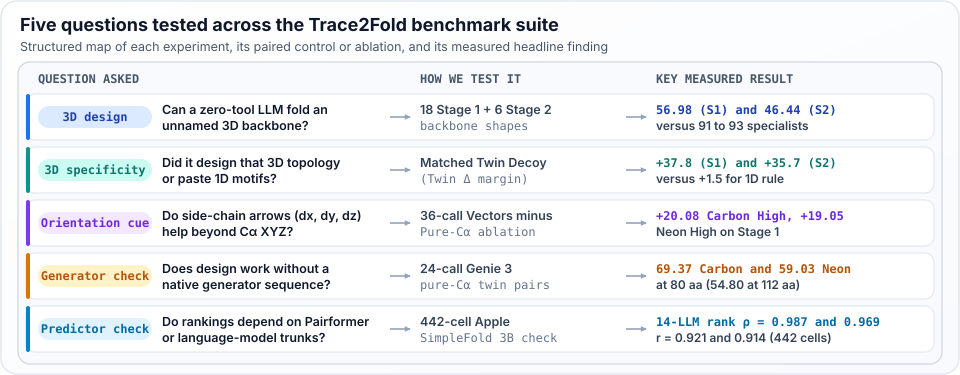

### Five empirical tests

| Test | Question answered | Primary metric | Evaluation scope |
| --- | --- | --- | --- |
| 1. 3D design | Does the predicted fold match the requested 3D target? | `spacefill-v4` consensus fit (0 to 100) and `<= 2.0 Å` hits | 18 Stage 1 shapes (48, 80, 112 aa) and 6 Stage 2 shapes (176 aa) |
| 2. 3D specificity | Does the sequence fit target A better than its matched 1D twin B? | `Twin Δ = Fit(A) − Fit(B)` | 9 Stage 1 twin pairs and 3 Stage 2 twin pairs |
| 3. Orientation cue | How much do `(dx, dy, dz)` side-chain vectors change accuracy relative to `Pure-Cα`? | `Vectors` minus `Pure-Cα` paired delta | 60 planned `Pure-Cα` slots across 6 frontier models |
| 4. Generator check | Do results transfer to backbones from a second independent diffusion generator? | `Pure-Cα` consensus fit on fresh `Genie 3` backbones | 2 fresh helical twin pairs (80 aa and 112 aa) |
| 5. Predictor check | Do model rankings hold under a third independent folding architecture? | Pearson `r` and Spearman `ρ` with `Apple SimpleFold 3B` | 442 folded cells across all 456 benchmark slots plus 128 variation inputs |

### Five reference controls

| Reference control | Input modality | Purpose in Trace2Fold | Stage 1 mean | Stage 2 mean |
| --- | --- | --- | ---: | ---: |
| Composition shuffle | Random permutation of specialist amino-acid composition | Zero-geometry noise floor | 8.79 | 6.56 |
| Local 1D `H/E/C` rule | Exact per-residue `H/E/C` labels with canonical propensities | Reference 1D secondary-structure baseline without 3D coordinates | 17.10 | 9.72 |
| `RFD4-Proteina` specialist | Co-generated sequence from the backbone diffusion model | Backbone designability check | 90.87 | 91.40 |
| `Cα-ProteinMPNN` (4 draws) | `Cα`-only graph neural network, lowest internal negative log-likelihood of 4 draws | Reference specialist performance on `Cα`-only geometry | 91.70 | 91.15 |
| `Vanilla ProteinMPNN` (4 draws) | Full 4-atom (`N, Cα, C, O`) graph neural network, best internal likelihood of 4 draws | Reference specialist performance with full backbone orientation | 91.37 | 93.15 |

## Exact Benchmark Prompts and Answer Extraction

Trace2Fold fixes the prompt wording and answer parser in code so every model receives identical instructions and coordinates. The following excerpts show the verbatim `v4.3` primary prompt (`vectors`) and `Pure-Cα` prompt (`geometry`) on the bundled 48-residue development target `gen-l48-02-b` (with residues 9 through 45 elided by `...` for display).

### Verbatim `v4.3` primary prompt (`vectors`)

```text
Choose one amino acid for each of the 48 positions in this single protein chain. We will predict its structure from your sequence alone and compare its Cα trace with the supplied coordinates at corresponding positions.
Work directly from this message and reply once. Do not use tools.
Return exactly 48 uppercase ASCII letters from ACDEFGHIKLMNPQRSTVWY on one line, with no spaces or explanation.

The vector (dx, dy, dz) gives the estimated unit direction from the backbone toward the side chain, in the same axes as x, y, z. It is derived from the backbone N, Cα and C atoms.
Cα coordinates in Å and side-chain directions (position x y z dx dy dz)
1 0.00 0.00 0.00 -0.29 0.10 -0.95
2 3.85 -0.00 0.00 0.52 -0.80 0.30
3 5.60 2.18 -2.53 0.16 0.98 0.11
4 8.55 0.72 -4.43 -0.05 -0.39 -0.92
5 11.94 2.54 -4.48 0.90 -0.44 -0.01
6 11.16 3.62 -8.10 -0.21 -0.61 -0.76
7 7.79 5.03 -7.10 -0.76 -0.52 0.38
8 9.38 6.84 -4.10 0.51 -0.44 0.74
...
46 2.50 23.50 -3.18 0.29 -0.38 -0.88
47 -0.73 25.51 -3.61 -0.88 -0.41 -0.25
48 -0.44 26.76 0.00 -0.02 -0.63 0.78
```

### Verbatim `v4.3` `Pure-Cα` prompt (`geometry`)

```text
Choose one amino acid for each of the 48 positions in this single protein chain. We will predict its structure from your sequence alone and compare its Cα trace with the supplied coordinates at corresponding positions.
Work directly from this message and reply once. Do not use tools.
Return exactly 48 uppercase ASCII letters from ACDEFGHIKLMNPQRSTVWY on one line, with no spaces or explanation.

Cα coordinates in Å (position x y z)
1 0.00 0.00 0.00
2 3.85 -0.00 0.00
3 5.60 2.18 -2.53
4 8.55 0.72 -4.43
5 11.94 2.54 -4.48
6 11.16 3.62 -8.10
7 7.79 5.03 -7.10
8 9.38 6.84 -4.10
...
46 2.50 23.50 -3.18
47 -0.73 25.51 -3.61
48 -0.44 26.76 0.00
```

### Difference between `v4.2` and `v4.3` prompt wording

Stage 1 used prompt version `v4.2`, whose opening line read:

```text
Choose one amino acid for each of the 48 positions. If a target backbone is supplied, choose a sequence whose predicted Cα trace matches the target as closely as possible at corresponding residue positions. Otherwise, choose a sequence likely to fold.
```

`v4.2` included that conditional sentence because the Stage 1 harness also supported length-only control prompts without coordinates. Stage 2 and the fresh `Genie 3` runs used `v4.3`, which removes the conditional clause (`Choose one amino acid for each of the 48 positions in this single protein chain. We will predict its structure from your sequence alone and compare its Cα trace with the supplied coordinates at corresponding positions.`) and states the single-line uppercase ASCII output rule explicitly.

### Deterministic `length-aware-v2` answer extraction

Every model reply passes through the deterministic `length-aware-v2` parser in `trace2fold/trials.py`. The parser strips optional Markdown code fences, searches for candidate strings composed exclusively of the 20 standard uppercase amino-acid letters (`ACDEFGHIKLMNPQRSTVWY`), and extracts the candidate matching the exact target length `N`. Responses without an exact-length canonical sequence score `0.00`.

## Scoring Formula and Why the `spacefill-v4` Weights Are Fair

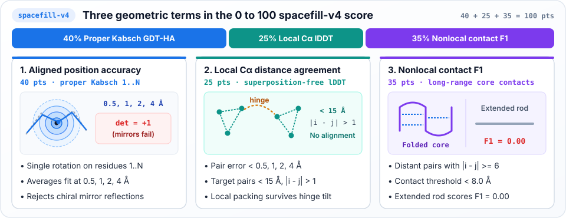

Trace2Fold scores each predicted `Cα` structure against a target backbone using the `spacefill-v4` composite metric on a `0` to `100` scale:

```text
Score = 100 × (0.40 × GDT-HA + 0.25 × Cα lDDT + 0.35 × Contact F1)
```

Each term grades a distinct geometric requirement so no single shortcut can inflate a score. When a target has no valid pairs for an optional term (`ca_lddt` or `contact_f1`), `trace2fold/metrics.py` renormalizes the weights across the defined components.

### 40% Single-Fit Proper-Kabsch Coverage at `GDT-HA` Cutoffs (`0.5, 1.0, 2.0, 4.0 Å`)

In `trace2fold/metrics.py`, `aligned_coverage` aligns predicted residues `1..N` onto target residues `1..N` with one proper rigid Kabsch rotation (`det(R) = +1`) and averages residue fractions within the `GDT-HA` cutoffs (`0.5 Å`, `1.0 Å`, `2.0 Å`, and `4.0 Å`). This single-fit coverage differs from multi-superposition optimized `GDT-HA`.

Enforcing `det(R) = +1` checks right-handed chirality: a mirror-reflected chain preserves every pairwise distance and scores about `65.7` on pure distance metrics, yet fails proper superposition. Averaging four cutoffs also stops one flexible terminus from dominating the score the way raw `RMSD` does.

### 25% Local `Cα lDDT` (`< 15 Å`, `|i − j| > 1`)

Local `Cα lDDT` evaluates the preservation of inter-residue distances shorter than `15 Å` for non-adjacent pairs (`|i − j| > 1`) across standard thresholds (`0.5, 1.0, 2.0, 4.0 Å`). This term rewards accurate local helices, beta-strand registers, and tight hairpin geometry even when a slight global hinge shifts two subdomains apart.

### 35% Nonlocal `Contact F1` (`< 8 Å`, `|i − j| >= 6`)

Nonlocal `Contact F1` computes the harmonic mean of precision and recall on long-range `Cα` contacts within `8.0 Å` separated by at least 6 sequence positions. Giving tertiary contacts 35% of the score directly grades 3D core closure: unfolded chains fail contact recall, and over-compacted wrong topologies fail contact precision.

### Why `pLDDT` and `pTM` carry 0% weight

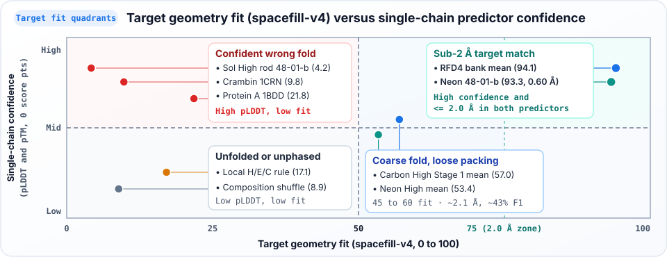

Single-chain predictor confidence (`pLDDT` and `pTM`) measures whether a sequence folds into *some* stable structure, not whether it matches the target coordinates. Keeping `pLDDT` and `pTM` at 0% weight stops models from gaming the leaderboard with confident generic helices.

On the 48-residue beta-meander `release-l48-01-b`, `GPT-6.2 Sol High` designed a charged alpha-helical rod with a Boltz-2 `pTM` of `0.473` yet scored `4.20` on `spacefill-v4` because the fold ignored all five target beta-strands.

### Why multi-predictor consensus prevents overfitting

The primary score averages `ESMFold2-Fast` (a protein language-model folder) and `Boltz-2` (a diffusion folder), both run in single-sequence, zero-MSA, zero-template mode. Averaging two distinct model families prevents sequences from exploiting quirks of a single folding network, and `Apple SimpleFold 3B` provides a third architectural check across all `442` folded cells of the `456`-slot benchmark matrix plus `128` variation folds.

### Weight sensitivity and effective variance shares across 10,000 weightings

Nominal weights (`40%` single-fit `GDT-HA`, `25%` `Cα lDDT`, `35%` `Contact F1`) differ from how much each term moves the 14-LLM ranking. `Cα lDDT` carries a nonzero floor (`0.20` to `0.35`) on compact chains, whereas `Contact F1` has the widest 14-LLM spread (`SD = 17.44` points versus `12.07` for `Cα lDDT` and `9.99` for `GDT-HA`).

Measured by `w_k · Cov(X_k, S) / Var(S)` across the 14 LLM settings on all 24 shapes, the canonical `40 / 25 / 35` score draws `30.3%` of its variance from `GDT-HA`, `22.9%` from `Cα lDDT`, and `46.8%` from `Contact F1`.

Across `10,000` weightings within `±0.15` of `40 / 25 / 35`, median Spearman `ρ` against canonical scores is `0.9912` (`min 0.9824`). Across `10,000` uniform draws on the full weight triangle (`Dirichlet(1, 1, 1)`), median `ρ` is `0.9824` (`min 0.9736`), and (`Gemini 4 Carbon High`, `Gemini 4 Hydrogen XHigh`, `Gemini 4 Neon High`) stays top-3 in `100.0%` of draws.

| Weight preset | Weights (GDT-HA / lDDT / Contact F1) | Effective variance share (14 LLMs) | #1 contestant (24 shapes) | #2 runner-up | #1 minus #2 gap | Spearman ρ versus 40/25/35 |
| --- | ---: | ---: | --- | --- | ---: | ---: |
| Canonical (40 / 25 / 35) | 40% / 25% / 35% | 30.3% / 22.9% / 46.8% | Gemini 4 Carbon High (51.89) | Gemini 4 Hydrogen XHigh (51.66) | +0.22 | 1.0000 |
| Equal (33 / 33 / 33) | 33% / 33% / 33% | 25.1% / 30.5% / 44.4% | Gemini 4 Carbon High (54.07) | Gemini 4 Hydrogen XHigh (54.03) | +0.04 | 0.9956 |
| GDT-HA 50 / 25 / 25 | 50% / 25% / 25% | 40.3% / 24.3% / 35.4% | Gemini 4 Carbon High (49.09) | Gemini 4 Hydrogen XHigh (48.47) | +0.61 | 0.9912 |
| Contact 25 / 25 / 50 | 25% / 25% / 50% | 17.3% / 21.1% / 61.6% | Gemini 4 Neon High (56.67) | Gemini 4 Hydrogen XHigh (56.45) | +0.22 | 0.9824 |
| Pure GDT-HA | 100% / 0% / 0% | 100.0% / 0.0% / 0.0% | Gemini 4 Carbon High (34.13) | Gemini 4 Hydrogen XHigh (31.81) | +2.32 | 0.9868 |
| Pure Cα lDDT | 0% / 100% / 0% | 0.0% / 100.0% / 0.0% | Gemini 4 Hydrogen XHigh (66.57) | Gemini 4 Carbon High (65.96) | +0.61 | 0.9868 |
| Pure Contact F1 | 0% / 0% / 100% | 0.0% / 0.0% / 100.0% | Gemini 4 Neon High (64.80) | Gemini 4 Hydrogen XHigh (63.71) | +1.09 | 0.9824 |

## Benchmark Data and Rankings

All numbers in the following tables are computed directly from the canonical public archives in `benchmarks/` (`spacefill-v4` consensus of `ESMFold2-Fast` and `Boltz-2`, single-sequence, zero-MSA, zero-template). Holdout coordinates and sequences remain private to prevent benchmark contamination; the 20 public `gen-*` development shapes and 4 experimental calibration targets ship in `data/`.

### Stage 1 rankings (18 matched shapes across 48, 80, and 112 residues)

Stage 1 evaluates 9 matched twin pairs (`18` shapes: 6 helical, 6 beta, and 6 mixed across `48`, `80`, and `112` residues) under prompt `v4.2` (`vectors`).

Leading models reach `53.35` to `56.98` (`Twin Δ` `+32.66` to `+37.01`), producing `20` seed-0 consensus `<= 2.0 Å` model-target hits across 14 settings (`9` of `18` distinct shapes, including `8` hits on `release-l48-01-b`). `Cα-ProteinMPNN` reaches `17/18` (`91.70`), and the `1D H/E/C` rule reaches `0/18` (`17.10`).

| Model or control | Score (seed 0) | 5-seed mean | Best-of-5 | Twin Δ | <= 2.0 Å (s0 / any-5) |
| --- | ---: | ---: | ---: | ---: | ---: |
| Gemini 4 Carbon High | 56.98 | 56.05 | 62.04 | +37.01 | 4/18 (6) |
| Gemini 4 Hydrogen XHigh | 54.09 | 53.17 | 57.76 | +32.66 | 3/18 (4) |
| Gemini 4 Neon High | 53.35 | 52.36 | 59.12 | +33.52 | 3/18 (7) |
| GPT-6.2 Sol XHigh | 47.55 | 46.28 | 52.70 | +27.37 | 2/18 (2) |
| Gemini 4 Hydrogen High | 43.62 | 43.85 | 49.31 | +22.32 | 0/18 (1) |
| GPT-6.2 Astra High | 42.99 | 41.66 | 45.20 | +24.65 | 3/18 (3) |
| Claude Fable 5.2 High | 37.49 | 37.32 | 39.86 | +18.05 | 1/18 (1) |
| GPT-6.2 Sol High | 37.41 | 36.49 | 41.05 | +17.24 | 0/18 (1) |
| Claude Opus 5.5 High | 34.02 | 33.76 | 36.88 | +14.72 | 1/18 (1) |
| GPT-6.1 Terra XHigh | 28.80 | 28.55 | 31.12 | +9.39 | 1/18 (1) |
| DeepSeek V4.1 Flash Max | 24.79 | 24.08 | 27.75 | +7.79 | 0/18 (0) |
| Claude Sonnet 5.5 XHigh | 24.11 | 24.24 | 25.70 | +4.53 | 1/18 (1) |
| GLM 5.3 Flash Max | 17.99 | 17.66 | 20.66 | +5.94 | 0/18 (0) |
| Claude Sonnet 5.5 High | 17.56 | 17.21 | 18.31 | +5.85 | 1/18 (1) |
| Cα-ProteinMPNN (4 draws, internal likelihood) | 91.70 | 91.79 | 92.89 | +69.33 | 17/18 (17) |
| Vanilla ProteinMPNN (4-atom, 4 draws) | 91.37 | 91.21 | 92.04 | +69.29 | 17/18 (17) |
| Specialist reference (RFD4-Proteina) | 90.87 | 90.58 | 91.55 | +68.97 | 17/18 (17) |
| Local secondary-structure rule | 17.10 | 17.85 | 21.11 | +1.46 | 0/18 (1) |
| Composition shuffle | 8.79 | 8.87 | 10.36 | +0.00 | 0/18 (0) |

#### Paired reasoning-effort comparison in Stage 1 (`High` versus `XHigh`)

Three model families ran on identical Stage 1 targets at both `High` and `XHigh` reasoning settings (one reply per shape). Every tested family improved by `+6.55` to `+10.48` points at `XHigh` and won 12 or 13 of the 18 paired shapes.

| Model family | High mean (18 shapes) | XHigh mean (18 shapes) | XHigh minus High | Shapes won by XHigh |
| --- | ---: | ---: | ---: | ---: |
| Gemini 4 Hydrogen | 43.62 | 54.09 | +10.48 | 12/18 |
| GPT-6.2 Sol | 37.41 | 47.55 | +10.13 | 12/18 |
| Claude Sonnet 5.5 | 17.56 | 24.11 | +6.55 | 13/18 |

### Stage 2 rankings (6 matched shapes at 176 residues)

Stage 2 tests 3 fresh `RFD4-Proteina` twin pairs (`6` shapes: helical Pair 01 at `>= 70%` `H/E/C`, strand-rich Pair 02 at relaxed `66.5%` `H/E/C`, and mixed Pair 03 at `>= 70%` `H/E/C`) under prompt `v4.3` (`vectors`).

Across `84` model evaluations (`78` folded sequences), evaluated models record `0/78` consensus `<= 2.0 Å` hits. `Vanilla ProteinMPNN` reaches `93.15` (`5/6` `<= 2.0 Å`) and `Cα-ProteinMPNN` reaches `91.15` (`6/6` `<= 2.0 Å`).

Leave-one-pair-out (`LOPO`) ranges report sensitivity when dropping each of the three 176-residue twin pairs. On the `66.5%` beta pair, the `Local 1D H/E/C rule` records a mean `Twin Δ` of `+0.35`, confirming negligible 1D shortcut signal.

| Model or control | Score (seed 0) | 5-seed mean | Best-of-5 | Twin Δ | <= 2.0 Å | Helical | Beta (66.5% H/E/C) | Mixed | LOPO range |
| --- | ---: | ---: | ---: | ---: | ---: | ---: | ---: | ---: | ---: |
| Gemini 4 Neon High | 46.44 | 44.75 | 48.76 | +35.71 | 0/6 | 49.13 | 38.94 | 51.24 | [44.03, 50.19] |
| Gemini 4 Hydrogen XHigh | 44.38 | 43.42 | 49.10 | +34.43 | 0/6 | 40.41 | 42.19 | 50.54 | [41.30, 46.36] |
| Gemini 4 Carbon High | 36.61 | 37.17 | 40.79 | +25.63 | 0/6 | 34.60 | 36.01 | 39.22 | [35.30, 37.61] |
| GPT-6.2 Astra High | 28.29 | 29.30 | 32.89 | +18.51 | 0/6 | 22.51 | 24.95 | 37.40 | [23.73, 31.17] |
| Gemini 4 Hydrogen High | 28.23 | 28.38 | 31.14 | +19.37 | 0/6 | 31.04 | 38.44 | 15.20 | [23.12, 34.74] |
| GPT-6.2 Sol XHigh | 25.91 | 26.65 | 30.33 | +15.41 | 0/6 | 26.71 | 18.52 | 32.50 | [22.62, 29.61] |
| GPT-6.2 Sol High | 23.86 | 22.25 | 26.42 | +15.94 | 0/6 | 27.03 | 13.19 | 31.37 | [20.11, 29.20] |
| Claude Fable 5.2 High | 23.60 | 23.08 | 24.81 | +12.37 | 0/6 | 19.18 | 23.79 | 27.84 | [21.48, 25.81] |
| Claude Opus 5.5 High | 20.34 | 20.68 | 23.41 | +9.64 | 0/6 | 18.19 | 17.27 | 25.55 | [17.73, 21.87] |
| GPT-6.1 Terra XHigh | 17.04 | 17.69 | 19.24 | +7.38 | 0/6 | 17.20 | 13.28 | 20.64 | [15.24, 18.92] |
| Claude Sonnet 5.5 XHigh | 13.05 | 12.61 | 13.96 | +4.81 | 0/6 | 16.05 | 11.52 | 11.59 | [11.55, 13.82] |
| DeepSeek V4.1 Flash Max | 9.98 | 9.51 | 10.16 | +3.51 | 0/6 | 16.21 | 10.56 | 3.17 | [6.87, 13.39] |
| GLM 5.3 Flash Max | 7.93 | 8.10 | 8.91 | +2.71 | 0/6 | 14.48 | 0.00 | 9.30 | [4.65, 11.89] |
| Claude Sonnet 5.5 High | 5.60 | 5.67 | 6.04 | -0.35 | 0/6 | 8.12 | 5.81 | 2.87 | [4.34, 6.96] |
| Vanilla ProteinMPNN (4-atom, 4 draws) | 93.15 | 93.01 | 93.82 | +81.53 | 5/6 | 93.59 | 90.88 | 94.98 | [92.23, 94.29] |
| Specialist reference (RFD4-Proteina) | 91.40 | 91.79 | 94.65 | +79.84 | 5/6 | 94.41 | 85.78 | 94.00 | [90.00, 94.21] |
| Cα-ProteinMPNN (4 draws, internal likelihood) | 91.15 | 90.51 | 91.83 | +79.57 | 6/6 | 92.55 | 88.03 | 92.88 | [90.29, 92.72] |
| Local secondary-structure rule | 9.72 | 9.85 | 10.86 | +1.79 | 0/6 | 6.99 | 8.19 | 13.98 | [7.59, 11.08] |
| Composition shuffle | 6.56 | 6.31 | 6.84 | +0.00 | 0/6 | 8.00 | 6.06 | 5.60 | [5.84, 7.03] |

### Four-length scaling across 24 matched shapes (48 to 176 residues)

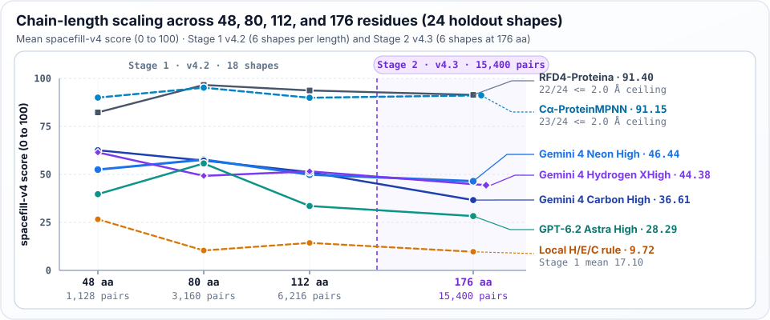

Combining Stage 1 (18 shapes) and Stage 2 (6 shapes) yields 24 matched holdout shapes with 6 shapes at each of four chain lengths (`48`, `80`, `112`, and `176` residues).

Specialist inverse-folding controls achieve 24-shape means of `91.00` to `91.81` (`82.31` to `96.58` across individual length panels). Leading zero-tool model settings average `50` to `62` across `48` to `112` residues and `36.61` to `46.44` at `176` residues, noting that Stage 2 also introduces new `176 aa` targets, `v4.3` prompt wording, and the `66.5%` beta `H/E/C` tier.

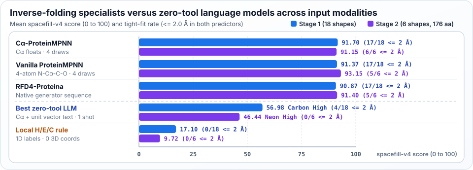

| Model or control | Type | 48 aa (6 shapes) | 80 aa (6 shapes) | 112 aa (6 shapes) | 176 aa (6 shapes) | 24-shape mean |
| --- | --- | ---: | ---: | ---: | ---: | ---: |
| Gemini 4 Carbon High | Evaluated model | 62.57 | 57.20 | 51.17 | 36.61 | 51.89 |
| Gemini 4 Hydrogen XHigh | Evaluated model | 61.45 | 49.23 | 51.60 | 44.38 | 51.66 |
| Gemini 4 Neon High | Evaluated model | 52.49 | 57.69 | 49.87 | 46.44 | 51.62 |
| GPT-6.2 Sol XHigh | Evaluated model | 56.33 | 54.40 | 31.91 | 25.91 | 42.14 |
| Gemini 4 Hydrogen High | Evaluated model | 45.58 | 43.99 | 41.28 | 28.23 | 39.77 |
| GPT-6.2 Astra High | Evaluated model | 39.70 | 55.72 | 33.56 | 28.29 | 39.32 |
| GPT-6.2 Sol High | Evaluated model | 31.10 | 50.24 | 30.89 | 23.86 | 34.02 |
| Claude Fable 5.2 High | Evaluated model | 43.24 | 39.79 | 29.44 | 23.60 | 34.02 |
| Claude Opus 5.5 High | Evaluated model | 39.65 | 37.18 | 25.24 | 20.34 | 30.60 |
| GPT-6.1 Terra XHigh | Evaluated model | 44.01 | 21.31 | 21.07 | 17.04 | 25.86 |
| Claude Sonnet 5.5 XHigh | Evaluated model | 31.71 | 22.66 | 17.97 | 13.05 | 21.35 |
| DeepSeek V4.1 Flash Max | Evaluated model | 24.10 | 32.58 | 17.70 | 9.98 | 21.09 |
| GLM 5.3 Flash Max | Evaluated model | 22.05 | 24.41 | 7.51 | 7.93 | 15.47 |
| Claude Sonnet 5.5 High | Evaluated model | 28.02 | 14.63 | 10.02 | 5.60 | 14.57 |
| Vanilla ProteinMPNN (4-atom, 4 draws) | Reference control | 85.23 | 96.02 | 92.86 | 93.15 | 91.81 |
| Cα-ProteinMPNN (4 draws, internal likelihood) | Reference control | 90.01 | 95.18 | 89.92 | 91.15 | 91.56 |
| Specialist reference (RFD4-Proteina) | Reference control | 82.31 | 96.58 | 93.72 | 91.40 | 91.00 |
| Local secondary-structure rule | Reference control | 26.63 | 10.37 | 14.32 | 9.72 | 15.26 |
| Composition shuffle | Reference control | 10.85 | 7.88 | 7.64 | 6.56 | 8.23 |

#### Top-tier 24-shape uncertainty and exact 4,096 sign-flip comparisons

Across all 24 shapes (`12` twin pairs), the top three LLM settings span `0.27` points, led by `Gemini 4 Carbon High` (`51.89`), `Gemini 4 Hydrogen XHigh` (`51.66`), and `Gemini 4 Neon High` (`51.62`). Dropping one twin pair at a time changes the #1 model on `9` of `12` deletions (`Hydrogen XHigh` leads on `6`, `Neon High` on `3`, and `Carbon High` on `3`).

Enumerating all `2^12 = 4,096` ways to flip the signs of the 12 twin-pair differences gives two-sided `p = 0.9253` to `0.9878` inside the top three, showing no clear ordering among them on this 24-shape panel. All three top-tier settings exceed fourth-place `GPT-6.2 Sol XHigh` (`42.14`) by `+9.49` to `+9.75` points (exploratory unadjusted two-sided sign-flip `p = 0.0249` to `0.0386`).

| Contestant A | Contestant B | 24-shape diff (A minus B) | Paired t 95% range (df=11) | Deletion range (drop 1 pair) | Exact 4,096 sign-flip p | Comparison result |
| --- | --- | ---: | ---: | ---: | ---: | --- |
| Gemini 4 Carbon High | Gemini 4 Hydrogen XHigh | +0.22 | [-7.78, +8.23] | [-2.25, +3.21] | 0.9541 | No clear ordering on panel |
| Gemini 4 Carbon High | Gemini 4 Neon High | +0.27 | [-6.27, +6.80] | [-0.90, +1.86] | 0.9253 | No clear ordering on panel |
| Gemini 4 Carbon High | GPT-6.2 Sol XHigh | +9.75 | [+1.44, +18.07] | [+7.97, +12.32] | 0.0303 | Separated across 12 pairs |
| Gemini 4 Hydrogen XHigh | Gemini 4 Neon High | +0.04 | [-6.35, +6.43] | [-1.50, +1.36] | 0.9878 | No clear ordering on panel |
| Gemini 4 Hydrogen XHigh | GPT-6.2 Sol XHigh | +9.53 | [+0.80, +18.26] | [+7.88, +11.23] | 0.0386 | Separated across 12 pairs |
| Gemini 4 Neon High | GPT-6.2 Sol XHigh | +9.49 | [+1.80, +17.17] | [+8.17, +10.69] | 0.0249 | Separated across 12 pairs |

#### Reasoning-effort scaling on Mixed α/β shapes (4 shapes)

To test whether higher reasoning effort improves tertiary α/β packing on longer chains, we evaluated `GPT-6.2 Astra` (`High`, `XHigh`, and `Max`) and `Claude Fable 5.2` (`High` and `XHigh`) on 4 matched Mixed α/β holdout shapes (`112` and `176` residues). Five-seed metrics report matched-seed `ESMFold2-Fast` and `Boltz-2` consensus alongside seed-`0` `SimpleFold 3B`.

| Model or control | 4-shape mean | 5-seed mean | SimpleFold 3B (s0) | Twin Δ | <= 2.0 Å | 112-09-A | 112-09-B | 176-03-A | 176-03-B | n |
| --- | ---: | ---: | ---: | ---: | ---: | ---: | ---: | ---: | ---: | ---: |
| GPT-6.2 Astra Max | 42.74 | 43.66 | 32.94 | +28.42 | 0/4 (0) | 41.61 | 60.84 | 27.61 | 40.89 | 4/4 |
| GPT-6.2 Astra XHigh | 37.53 | 39.52 | 35.22 | +22.46 | 0/4 (0) | 45.36 | 35.95 | 24.99 | 43.80 | 4/4 |
| Claude Fable 5.2 XHigh | 35.57 | 35.79 | 49.31 | +21.14 | 0/4 (0) | 46.15 | 37.58 | 22.31 | 36.23 | 4/4 |
| Cα-ProteinMPNN (4 draws, internal likelihood) | 89.21 | 89.06 | 82.72 | +74.85 | 3/4 (3) | 92.94 | 78.13 | 93.88 | 91.89 | 4/4 |
| Gemini 4 Neon High | 51.53 | 49.15 | 50.23 | +37.27 | 0/4 (0) | 45.09 | 58.53 | 42.51 | 59.98 | 4/4 |
| Gemini 4 Hydrogen XHigh | 50.29 | 52.28 | 46.40 | +37.31 | 0/4 (0) | 51.21 | 48.87 | 36.25 | 64.83 | 4/4 |
| Gemini 4 Carbon High | 46.34 | 46.09 | 38.45 | +32.70 | 0/4 (0) | 51.46 | 55.46 | 31.09 | 47.35 | 4/4 |
| GPT-6.2 Astra High | 39.93 | 39.27 | 33.95 | +26.62 | 0/4 (0) | 41.59 | 43.35 | 22.42 | 52.38 | 4/4 |
| GPT-6.2 Sol XHigh | 35.78 | 37.94 | 31.19 | +22.49 | 0/4 (0) | 44.75 | 33.36 | 25.86 | 39.13 | 4/4 |
| Claude Fable 5.2 High | 35.22 | 34.95 | 29.69 | +20.77 | 0/4 (0) | 39.32 | 45.89 | 25.12 | 30.55 | 4/4 |
| Claude Opus 5.5 High | 32.66 | 33.93 | 33.12 | +18.46 | 0/4 (0) | 36.78 | 42.74 | 26.39 | 24.72 | 4/4 |

### Representation and generator ablations (`Vectors` versus `Pure-Cα` and `Genie 3`)

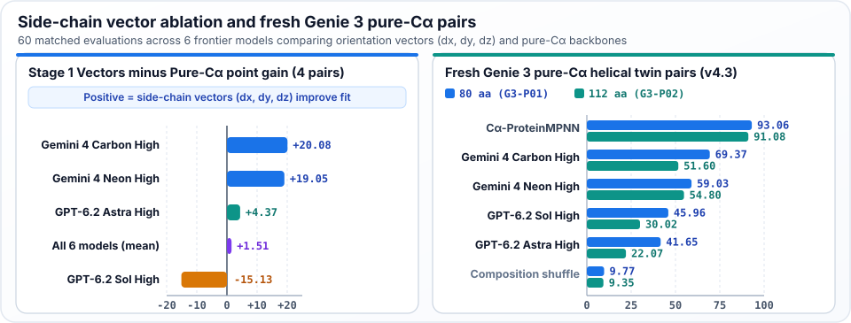

A 60-call suite across six models comprises 36 `Pure-Cα` (`x y z`) evaluations paired against corresponding `Vectors` (`x y z dx dy dz`) runs (one target from each of four Stage 1 `v4.2` twin pairs and two Stage 2 `v4.3` twin pairs) plus 24 `Pure-Cα` evaluations on two fresh `Genie 3` helical twin pairs (`G3-P01` at `80 aa` and `G3-P02` at `112 aa`).

Across all six models, `Vectors` minus `Pure-Cα` averages `+1.51` points in Stage 1 (`4` paired shapes per model) and `-0.61` points in Stage 2 (`2` paired shapes per model at `176 aa`).

Individual model families respond differently to those six-column tables. In Stage 1, `Gemini 4 Carbon High` (`+20.08`) and `Gemini 4 Neon High` (`+19.05`) gain strongly, whereas `GPT-6.2 Sol High` (`-15.13`) drops on the same targets.

#### Stage 1 `v4.2` (4 shapes, `Vectors` minus `Pure-Cα`)

| Model | Shapes | Consensus Δ | ESMFold2-Fast Δ | Boltz-2 Δ |
| --- | ---: | ---: | ---: | ---: |
| Gemini 4 Carbon High | 4 | +20.09 | +21.64 | +18.52 |
| Gemini 4 Neon High | 4 | +19.05 | +20.24 | +17.86 |
| GPT-6.2 Astra High | 4 | +4.37 | +1.51 | +7.22 |
| GPT-6.2 Sol High | 4 | -15.12 | -8.22 | -22.03 |
| Claude Opus 5.5 High | 4 | +5.45 | +6.08 | +4.83 |
| GLM 5.3 Flash Max | 4 | -24.74 | -24.32 | -25.16 |
| All 6 models (mean) | 24 | +1.51 | +2.82 | +0.21 |

#### Stage 2 `v4.3` (2 shapes, `Vectors` minus `Pure-Cα`)

| Model | Shapes | Consensus Δ | ESMFold2-Fast Δ | Boltz-2 Δ |
| --- | ---: | ---: | ---: | ---: |
| GPT-6.2 Astra High | 2 | +9.43 | +7.36 | +11.49 |
| Gemini 4 Carbon High | 2 | -0.10 | -6.33 | +6.14 |
| GLM 5.3 Flash Max | 2 | -1.76 | -5.02 | +1.50 |
| Gemini 4 Neon High | 2 | -3.35 | -9.88 | +3.17 |
| GPT-6.2 Sol High | 2 | -5.34 | -8.02 | -2.65 |
| Claude Opus 5.5 High | 2 | -2.54 | -7.54 | +2.46 |
| All 6 models (mean) | 12 | -0.61 | -4.91 | +3.69 |

#### Fresh `Genie 3` helical twin pairs (`Pure-Cα`, `v4.3`)

On two independent helical `Genie 3` twin pairs, `Gemini 4 Carbon High` reaches `69.37` at `80 aa` and `Gemini 4 Neon High` reaches `54.80` at `112 aa`, showing zero-tool 3D design transfer on helical backbones outside `RFD4-Proteina`.

| Model or control | Type | Genie 3 80 aa (G3-P01) Consensus | G3-P01 SimpleFold 3B | Genie 3 112 aa (G3-P02) Consensus | G3-P02 SimpleFold 3B |
| --- | --- | ---: | ---: | ---: | ---: |
| Cα-ProteinMPNN (4 draws) | Reference control | 93.06 | 90.60 | 91.08 | 89.07 |
| Gemini 4 Carbon High | Evaluated model | 69.37 | 67.68 | 51.60 | 53.43 |
| Gemini 4 Neon High | Evaluated model | 59.03 | 59.30 | 54.80 | 58.35 |
| GPT-6.2 Sol High | Evaluated model | 45.96 | 50.62 | 30.02 | 24.59 |
| GPT-6.2 Astra High | Evaluated model | 41.65 | 36.17 | 22.07 | 19.48 |
| Claude Opus 5.5 High | Evaluated model | 19.03 | 18.47 | 6.38 | 5.38 |
| GLM 5.3 Flash Max | Evaluated model | 0.00 | 0.00 | 8.87 | 10.32 |
| Composition shuffle | Reference control | 9.77 | 9.29 | 9.35 | 7.87 |
| Local secondary-structure rule | Reference control | 15.43 | 23.66 | 12.85 | 17.84 |

### Third-predictor concordance (`Apple SimpleFold 3B`)

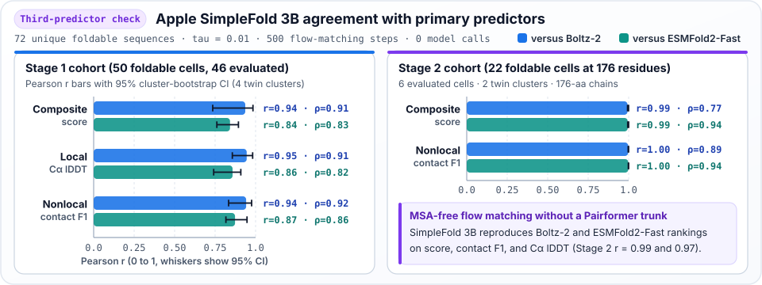

To check that rankings do not depend on `ESMFold2-Fast` or `Boltz-2`, we graded all `442` folded sequences across the `456`-slot benchmark matrix (`14` evaluated model settings and `5` controls across `24` targets) plus `128` variation inputs with `Apple SimpleFold 3B` (`500` steps, `τ = 0.01`, `seed = 0`, single sequence).

Across all `442` folded benchmark cells, `SimpleFold 3B` matches `ESMFold2-Fast` at `r = 0.921 / ρ = 0.919` and `Boltz-2` at `r = 0.914 / ρ = 0.906`. Across the `14` evaluated model means (kept separate from the `5` reference controls), Spearman rank `ρ` reaches `0.987` with `ESMFold2-Fast` and `0.969` with `Boltz-2`.

| Evaluation panel | Folded cells | Twin pairs | SimpleFold versus ESMFold2-Fast (r / ρ) | SimpleFold versus Boltz-2 (r / ρ) | Model-mean rank ρ |
| --- | ---: | ---: | ---: | ---: | --- |
| All 24 shapes (456-slot matrix) | 442 | 12 | 0.921 / 0.919 | 0.914 / 0.906 | 14/14 model ρ = 0.987 / 0.969 |
| Stage 1 v4.2 (342-slot matrix) | 334 | 9 | 0.907 / 0.905 | 0.905 / 0.896 | Included in 24-shape rank check |
| Stage 2 v4.3 (114-slot matrix) | 108 | 3 | 0.961 / 0.932 | 0.935 / 0.918 | Included in 24-shape rank check |
| Stage 1 v4.2 (Pure-Cα + Vectors) | 70 | 4 | 0.864 / 0.851 | 0.946 / 0.929 | Per-cell check |
| Stage 2 v4.3 (176 aa Pure-Cα + Vectors) | 32 | 2 | 0.966 / 0.952 | 0.957 / 0.924 | Per-cell check |
| Fresh Genie 3 v4.3 (80 and 112 aa Pure-Cα) | 26 | 2 | 0.957 / 0.963 | 0.977 / 0.957 | Per-cell check |

### Structural novelty (`PDB100`) and sequence diagnostics

We screened holdout backbones against the `PDB100` snapshot (`324,204` indexed chains) using `Foldseek` prefiltering and exact `US-align` on length-compatible hits. On the 18 scored Stage 1 targets, `1/18` matched `PDB100` at bidirectional `TM >= 0.85` and `5/18` at `TM >= 0.70`, alongside `3/144` (all helical) and `37/144` across the full pool.

Across the 6 Stage 2 targets (`3,748` Foldseek returned hits), `0/6` had a full-chain match and `0/6` had a partial or subdomain match at `TM >= 0.85` among the `693` length-compatible aligned candidates.

Sequence and contact-separation diagnostics across `318` analyzed model-designed sequences (`242` in Stage 1 and `76` in Stage 2) show balanced residue diversity, strong beta-branched (`Ile/Val/Thr`) strand placement, and sharp recall decay for contacts separated by `>= 48` sequence positions.

| Diagnostic metric | Stage 1 folded sequences (n=242) | Stage 2 folded sequences (n=76) | Interpretation |
| --- | ---: | ---: | --- |
| Normalized sequence entropy (0 to 1) | 0.7812 | 0.7842 | High alphabet diversity rather than low-complexity repeats |
| Effective alphabet size (1 to 20) | 10.66 | 10.80 | Uses roughly 11 effective amino acids per sequence |
| Longest homopolymer run (residues) | 1.81 | 2.08 | Minimal poly-residue runs |
| Maximum single-residue fraction | 0.1906 | 0.1971 | Balanced residue composition across lengths |
| Ile/Val/Thr fraction on beta positions | 0.4765 | 0.5151 | Strong beta-branched residue enrichment on strands |
| Ile/Val/Thr beta minus non-beta enrichment | +0.2614 | +0.2653 | Selective strand placement persists at 176 residues |
| ESMFold2-Fast long minus short contact recall | -0.2814 | -0.3003 | Recall drops 28% to 30% at sequence separation >= 48 |
| Boltz-2 long minus short contact recall | -0.2515 | -0.2357 | Independent diffusion folder confirms long-range recall decay |

## What These Scores Tell Us About Frontier Models

Benchmark scores alone do not identify the internal algorithm a language model uses to map coordinate tables into amino-acid sequences. Five testable interpretations explain the current measurements and point to concrete follow-up experiments.

### 1. Target preference beyond the 1D `H/E/C` control

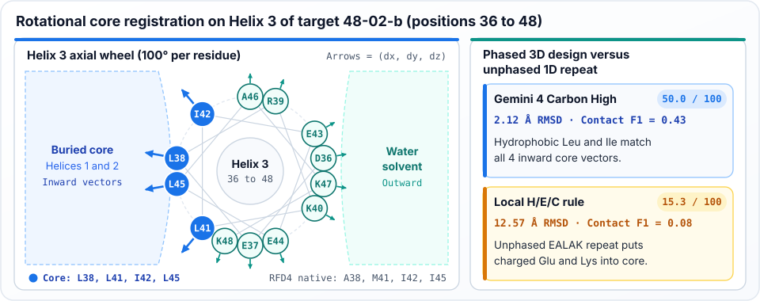

Leading models reach seed-0 `Twin Δ` of `+32.66` to `+37.01` in Stage 1 and `+34.43` to `+35.71` in Stage 2, whereas the `1D H/E/C` control averages `+1.46` and `+1.79` (even though paired twins still differ at up to `30%` to `33.5%` of 1D positions). That gap demonstrates preference for the assigned 3D target beyond simple 1D propensity matching.

Consistent with coordinate phasing, Helix 3 of public shape `gen-l48-02-b` places hydrophobes (`Leu`, `Ile`, `Val`, `Phe`) on inward `(dx, dy, dz)` vectors and charged residues (`Glu`, `Lys`, `Asp`) on solvent-facing vectors. In Stage 1, LLMs record `20` seed-0 `<= 2.0 Å` hits across `252` slots (`244` folded); on `release-l48-01-b`, `Gemini 4 Neon High` scores `93.32` versus `24.83` for `RFD4-Proteina`.

### 2. Canonical supersecondary assembly versus arbitrary 3D packing

A complementary interpretation is that frontier models recognize familiar supersecondary architectures (helical bundles, beta-meanders, and Rossmann-like α/β layers) from 3D coordinates and instantiate canonical sequence patterns (heptad repeats, alternating `Ile/Val/Thr` beta-strands, and `Gly/Pro/Asp/Asn` turns) rather than solving arbitrary continuous packing constraints.

That mechanism explains why scores hold near `50` to `62` across `48` to `112` residues, where local supersecondary motifs span most of the chain, yet fall to `0 / 78` sub-`2.0 Å` designs at `176` residues (`15,400` residue pairs), where within-stage long-range contact recall (`|i − j| >= 48`) sits `28` to `30` percentage points lower than short-range recall.

### 3. Model-specific use of orientation vectors (`Vectors` versus `Pure-Cα`)

Adding `(dx, dy, dz)` side-chain vectors helps some architectures and hurts others. In the Stage 1 ablation, `Gemini 4 Carbon High` gains `+20.08` points and `Gemini 4 Neon High` gains `+19.05` points, whereas `GPT-6.2 Sol High` loses `-15.13` points and `GLM 5.3 Flash Max` loses `-24.74` points.

Extra numeric columns supply direct rotamer-facing cues to models that track six-column tables cleanly, yet trigger attention or formatting regressions in models sensitive to wider numeric prompts.

### 4. Test-time compute (`High` versus `XHigh`) and fold-class priors

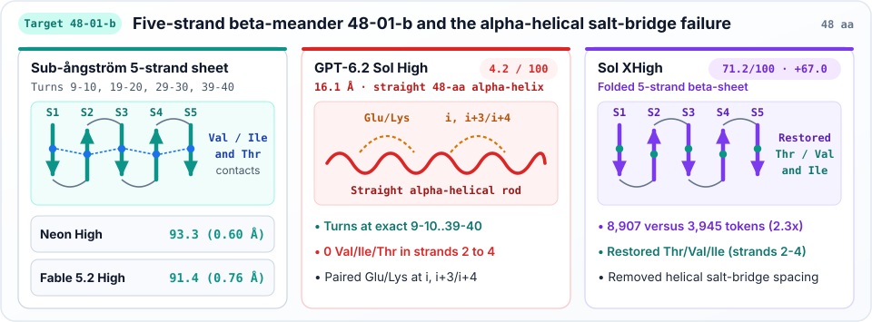

Increasing reasoning budget produces consistent gains across all three paired families (`+10.48` on `Gemini 4 Hydrogen`, `+10.13` on `GPT-6.2 Sol`, and `+6.55` on `Claude Sonnet 5.5` in Stage 1).

On the five-strand beta-meander `release-l48-01-b`, `GPT-6.2 Sol High` falls back to an alpha-helical salt-bridge prior (`4.20`), whereas `GPT-6.2 Sol XHigh` resolves all four hairpin turns and jumps to `71.18` (`+66.98` points). Longer reasoning traces let models override default helical priors and trace strand-to-strand pairings.

### 5. Scope and benchmark boundaries

- The 24 primary holdout shapes (`12` twin pairs) come from de novo `RFD4-Proteina` monomer backbones, supplemented by 4 independent `Genie 3` backbones in the generator check, rather than natural multi-domain, cofactor-bound, or multimeric complexes.
- Predictor agreement across `ESMFold2-Fast`, `Boltz-2`, and `Apple SimpleFold 3B` (`ρ = 0.80` to `0.99`) tests whether independent folding models predict the target 3D shape from sequence alone, not wet-lab expression yield, solubility, oligomeric state, melting temperature (`Tm`), or folding free energy (`ΔG`).
- Stage 1 (`18` shapes at `48`, `80`, and `112 aa`) used prompt `v4.2` and Stage 2 (`6` shapes at `176 aa`) used prompt `v4.3` with identical coordinate tables and explicit single-line output formatting.
- Holdout coordinates remain private to prevent training contamination; researchers can test locally on the `20` bundled `gen-*` shapes or request maintainer holdout evaluation following [CONTRIBUTING.md](CONTRIBUTING.md).

## Benchmark Tools and Academic Citations

Trace2Fold's core scoring harness requires only Python `3.11+` and `numpy`. The table lists the 10 external structure predictors, specialist baselines, backbone generators, and structural screening libraries used in the published benchmark. For a reference repository showing how to run `ESMFold2-Fast`, `Boltz-2`, `SimpleFold 3B`, `ProteinMPNN`, `RFD4-Proteina`, `Genie 3`, `Foldseek`, and `US-align`, see [BioSymphony/structure-factory](https://github.com/BioSymphony/structure-factory).

| Tool | Category | Role in Trace2Fold | Code or weights | Reference |
| --- | --- | --- | --- | --- |
| `ESMFold2-Fast` | Structure predictor | Primary single-sequence language-model predictor (`seeds 0–4`, no MSA) | [biohub/ESMFold2-Fast](https://huggingface.co/biohub/ESMFold2-Fast) · [facebookresearch/esm](https://github.com/facebookresearch/esm) | Lin et al., *Science* 2023 [1] |
| `Boltz-2` | Structure predictor | Primary single-sequence diffusion predictor (`msa: empty`, `seeds 0–4`) | [jwohlwend/boltz](https://github.com/jwohlwend/boltz) · [boltz-community/boltz-2](https://huggingface.co/boltz-community/boltz-2) | Passaro et al., 2025 [2] |
| `Apple SimpleFold 3B` | Structure predictor | Independent flow-matching concordance predictor (`seed 0`, research license) | [apple/ml-simplefold](https://github.com/apple/ml-simplefold) | Wang et al., 2025 [3] |
| `ProteinMPNN` / `Cα-ProteinMPNN` | Specialist ceiling | `Cα`-only and 4-atom inverse-folding reference ceilings (best internal likelihood of 4 draws) | [dauparas/ProteinMPNN](https://github.com/dauparas/ProteinMPNN) | Dauparas et al., *Science* 2022 [4] |
| `RFD4-Proteina` / `RFdiffusion` | Backbone generator | Holdout and starter backbone generation plus co-generated specialist sequence ceiling | [RosettaCommons/RFD4-Proteina](https://github.com/RosettaCommons/RFD4-Proteina) · [RosettaCommons/RFdiffusion](https://github.com/RosettaCommons/RFdiffusion) | Geffner et al., 2025 [5]; Watson et al., *Nature* 2023 [6] |
| `Genie 3` | Backbone generator | Sequence-free `Pure-Cα` de novo backbone generator transfer check | [aqlaboratory/genie3](https://github.com/aqlaboratory/genie3) | Lin et al., 2024 [7] |
| `Foldseek` | Structural search | Fast `PDB100` (`324,204` chains) structural prefilter | [steineggerlab/foldseek](https://github.com/steineggerlab/foldseek) | van Kempen et al., *Nature Biotech.* 2024 [8] |
| `US-align` | Structural search | Exact rigid `Cα` TM-score clustering and `PDB100` screening | [pylelab/USalign](https://github.com/pylelab/USalign) | Zhang et al., *Nature Methods* 2022 [9] |
| `Biotite` | Geometry library | `P-SEA` `Cα` secondary-structure (`H/E/C`) assignment for twin pairing | [biotite-dev/biotite](https://github.com/biotite-dev/biotite) | Kunzmann et al., *BMC Bioinformatics* 2023 [10] |
| `wwPDB` / `PDB100` | Structure archive | Experimental calibration fixtures (`1L2Y`, `1TRZ`, `1QY3`, `1I3V`) and novelty database | [rcsb.org](https://www.rcsb.org/) | Berman et al., *NAR* 2000 [11] |

### References

1. Lin, Z. et al. Evolutionary-scale prediction of atomic-level protein structure with a language model. *Science* **379**, 1123–1130 (2023). [doi:10.1126/science.ade2574](https://doi.org/10.1126/science.ade2574)
2. Passaro, S. et al. Boltz-2: Towards accurate and fast binding affinity prediction. *bioRxiv* (2025). [doi:10.1101/2025.06.14.659707](https://doi.org/10.1101/2025.06.14.659707)
3. Wang, Y. et al. SimpleFold: Folding proteins is simpler than you think. *arXiv:2509.18480* (2025). [arxiv.org/abs/2509.18480](https://arxiv.org/abs/2509.18480)
4. Dauparas, J. et al. Deep learning-based protein sequence design using ProteinMPNN. *Science* **378**, 49–56 (2022). [doi:10.1126/science.add2187](https://doi.org/10.1126/science.add2187)
5. Geffner, T. et al. Proteina: Scaling flow-based protein structure generative models. *ICLR* (2025). [arxiv.org/abs/2503.00710](https://arxiv.org/abs/2503.00710)
6. Watson, J. L. et al. De novo design of protein structure and function with RFdiffusion. *Nature* **620**, 1089–1100 (2023). [doi:10.1038/s41586-023-06415-8](https://doi.org/10.1038/s41586-023-06415-8)
7. Lin, Y., Lee, M., Zhang, Z. and AlQuraishi, M. Out of many, one: Designing and scaffolding proteins at the scale of the structural universe with Genie 2. *arXiv:2405.15489* (2024). [arxiv.org/abs/2405.15489](https://arxiv.org/abs/2405.15489)
8. van Kempen, M. et al. Fast and accurate protein structure search with Foldseek. *Nature Biotechnology* **42**, 243–246 (2024). [doi:10.1038/s41587-023-01773-0](https://doi.org/10.1038/s41587-023-01773-0)
9. Zhang, C., Shine, M., Pyle, A. M. and Zhang, Y. US-align: Universal structure alignments of proteins, nucleic acids, and macromolecular complexes. *Nature Methods* **19**, 1109–1115 (2022). [doi:10.1038/s41592-022-01585-1](https://doi.org/10.1038/s41592-022-01585-1)
10. Kunzmann, P. et al. Biotite: New tools for a versatile Python bioinformatics library. *BMC Bioinformatics* **24**, 236 (2023). [doi:10.1186/s12859-023-05345-6](https://doi.org/10.1186/s12859-023-05345-6)
11. Berman, H. M. et al. The Protein Data Bank. *Nucleic Acids Research* **28**, 235–242 (2000). [doi:10.1093/nar/28.1.235](https://doi.org/10.1093/nar/28.1.235)

## License and How to Cite Trace2Fold

Trace2Fold code, evaluation harness, documentation, and bundled public benchmark definitions are released under the **MIT License** (`Copyright (c) 2026 Jacob Vogan`; see [LICENSE](LICENSE)). Third-party folding models, backbone generators, and inverse-folding specialists referenced by `backends/` are distributed under their own upstream licenses (see [NOTICE.md](NOTICE.md)).

If you report Trace2Fold benchmark scores, reuse its prompts or `spacefill-v4` grading harness, or compare new language models against our published baselines, cite Trace2Fold using [CITATION.cff](CITATION.cff) or the following BibTeX entry:

```bibtex
@software{vogan2026trace2fold,
  author       = {Vogan, Jacob},
  title        = {Trace2Fold: Zero-Tool 3D Inverse Folding Benchmark},
  year         = {2026},
  version      = {0.4.0},
  url          = {https://github.com/jvogan/trace2fold},
  license      = {MIT}
}
```
